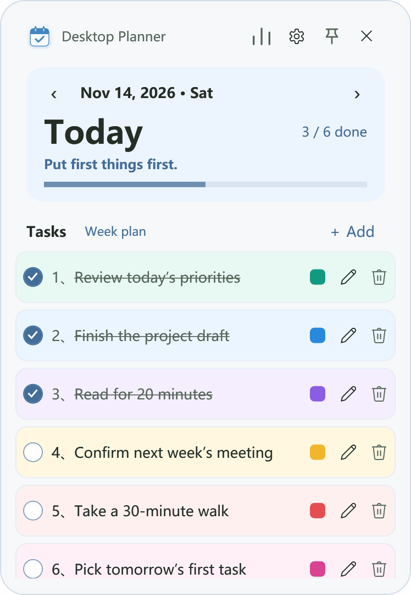
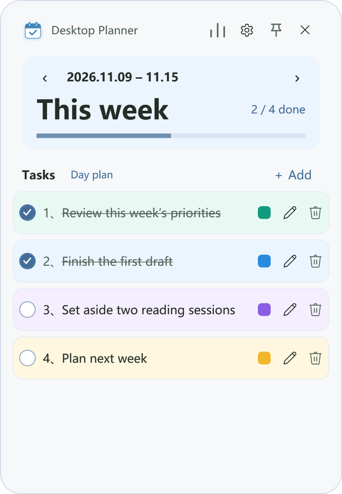

# Desktop Planner

A Windows planner that lives at the edge of your screen. Hover over the edge tab to open your plans, add or check off a task, then move away to tuck it back.

[简体中文](README.md) · [User guide](docs/usage.en.md) · [Report an issue](https://github.com/PASSIONYOUNGZ/desktop-planner/issues)

## Download

**Current release 1.2.4** · Windows 10 version 1903 or later, Windows 11 (x64)

| Edition | Includes | ZIP | Extracted | Download |
| --- | --- | ---: | ---: | --- |
| **Local** | Offline daily and weekly plans, progress, and export | 0.72 MB | 1.94 MB | [GitHub](https://github.com/PASSIONYOUNGZ/desktop-planner/releases/download/v1.2.4/desktop-planner-1.2.4-windows-x64-local.zip) · [CNB](https://cnb.cool/passionyoungz/desktop-planner/-/releases/download/v1.2.4/desktop-planner-1.2.4-windows-x64-local.zip) |
| **Full** | Everything in Local, plus optional two-way Feishu sync | 13.95 MB | 49.84 MB | [GitHub](https://github.com/PASSIONYOUNGZ/desktop-planner/releases/download/v1.2.4/desktop-planner-1.2.4-windows-x64-full.zip) · [CNB](https://cnb.cool/passionyoungz/desktop-planner/-/releases/download/v1.2.4/desktop-planner-1.2.4-windows-x64-full.zip) |

Extract the whole ZIP and run `DesktopPlanner.exe`. Both editions work offline without an account. Check for updates under **Settings → General → About & updates**.

## Screenshots

| Daily plan | Weekly plan | Progress overview |
| :---: | :---: | :---: |
|  |  |  |

[Personalization settings](screenshots/settings-en.png)

## Features

- **Plan your work.** Create daily and weekly plans, color-code tasks, and drag to reorder or move tasks between days. Carry over unfinished tasks from yesterday when today’s list is empty.
- **Keep it within reach.** Dock the window on any edge, pin it on top, resize it, launch it with Windows, or set your own new-task shortcut.
- **Review and export.** See completion rates by the last seven days, calendar week, calendar month, or all time. Export this week, this month, or your entire task history as Markdown or Word.
- **Make it yours.** Switch between English and Simplified Chinese, pick a preset or custom theme, and choose rotating, fixed, or custom daily quotes.

## Feishu sync

In the Full edition, go to **Settings → Data** and connect a Feishu document you can edit. Daily and weekly tasks, completion status, and task colors sync in the background. Two Windows PCs can share the same plans by connecting to the same document. You can also view the document in Feishu on your phone. When you switch documents, Desktop Planner tries your saved authorization first.

## Data and feedback

Plans are stored in the `Data` folder beside the app. Keep that folder when moving the app or backing up your plans. Preferences and Feishu authorization are stored in your Windows user profile.

Built by [PassionYoungz](https://github.com/PASSIONYOUNGZ). The Full edition includes the [official Feishu CLI](https://github.com/larksuite/cli) and its license. [Version history](CHANGELOG.md) · [Feedback](https://github.com/PASSIONYOUNGZ/desktop-planner/issues)

## Support

If Desktop Planner has been useful to you, you can scan this QR code to buy me a coffee.

  

