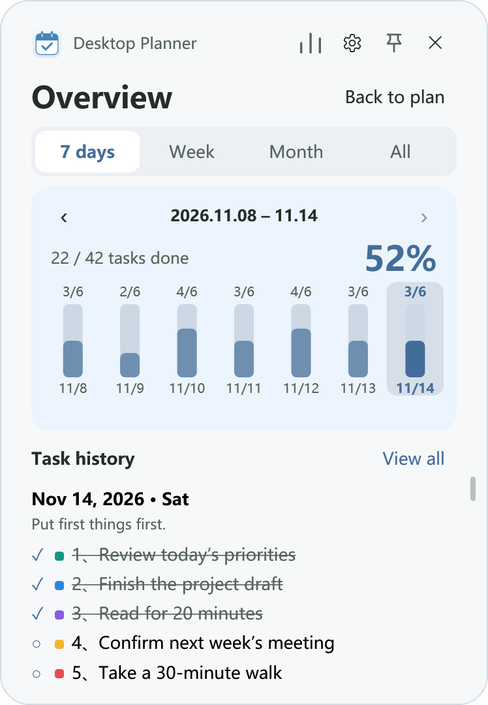
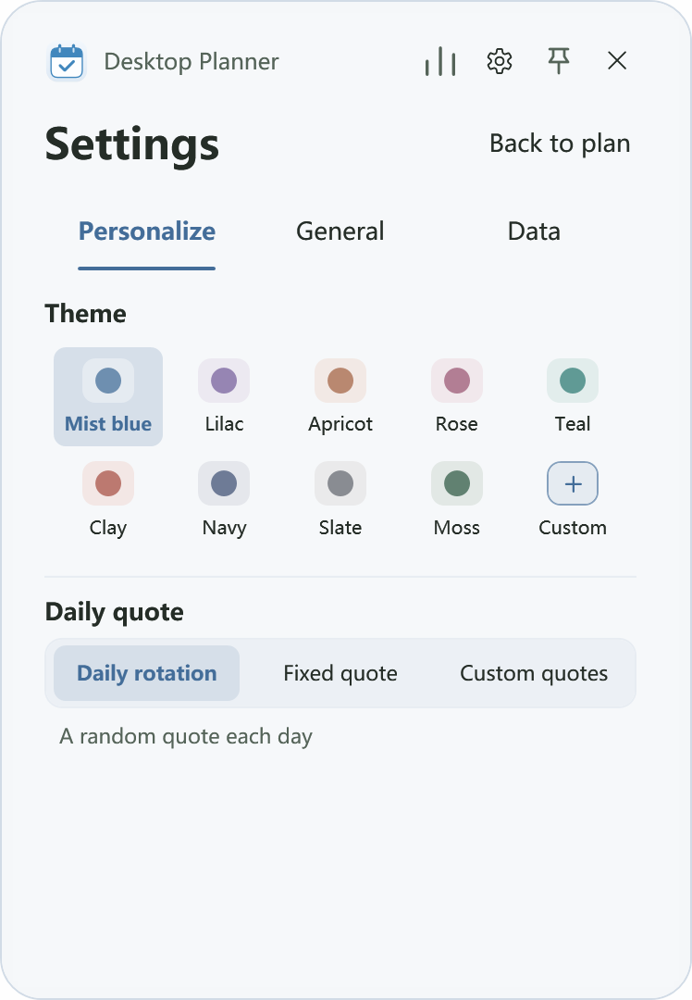

# Desktop Planner · 桌面日程

Keep your daily tasks and weekly goals at the edge of your Windows desktop. Hover to open the planner and let it tuck away when you move on.

[简体中文](README.md)

## Download

**Current release v1.2.3** · Windows 10 version 1903 or later and Windows 11 (x64).

| Edition | Includes | ZIP | Extracted | Download |
| --- | --- | ---: | ---: | --- |
| **Local** | Plans, color labels, edge docking, progress, quotes, and export | 0.72 MB | 1.94 MB | [GitHub](https://github.com/PASSIONYOUNGZ/desktop-planner/releases/download/v1.2.3/desktop-planner-1.2.3-windows-x64-local.zip) · [CNB](https://cnb.cool/passionyoungz/desktop-planner/-/releases/download/v1.2.3/desktop-planner-1.2.3-windows-x64-local.zip) |
| **Full** | All Local features plus optional two-way Feishu document sync | 13.94 MB | 49.84 MB | [GitHub](https://github.com/PASSIONYOUNGZ/desktop-planner/releases/download/v1.2.3/desktop-planner-1.2.3-windows-x64-full.zip) · [CNB](https://cnb.cool/passionyoungz/desktop-planner/-/releases/download/v1.2.3/desktop-planner-1.2.3-windows-x64-full.zip) |

Both are portable ZIP packages. Extract the entire ZIP, keep the files together, and open `DesktopPlanner.exe`. They use the .NET Framework 4.8 or 4.8.1 runtime included with supported Windows versions. Local planning works offline in both editions and requires no Codex or Feishu account.

For later releases, go to **Settings → General → About & updates**. In-app updates use CNB and download the matching edition, including for copies originally downloaded from GitHub.

## Screenshots

| Daily plan | Progress overview | Personalization |
| :---: | :---: | :---: |
|  |  |  |

[Weekly plan screenshot](screenshots/weekly-en.png)

## Features

- **Daily and weekly planning.** Check off tasks, assign colors, drag to reorder or move tasks between days, and carry unfinished tasks forward.
- **Desktop widget.** Edge docking, hover to open, pin on top, tray controls, resizable window, start with Windows, and an editable new-task shortcut.
- **Progress and export.** Review tasks by date, see completion charts, and export all records, this week, or this month to Markdown or Word.
- **Personalization.** English and Simplified Chinese, preset and custom colors, and rotating, fixed, or custom quotes.
- **Optional Feishu sync.** With the Full edition, connect a document you can edit from **Settings → Data**. Multiple Windows devices can sync tasks and completion status by authorizing the same document.

[Version history](CHANGELOG.md) · [Report an issue](https://github.com/PASSIONYOUNGZ/desktop-planner/issues)

Thanks to everyone who has tried the app and shared feedback. The Full edition includes the [official Feishu CLI](https://github.com/larksuite/cli). Third-party notices ship with the ZIP.
