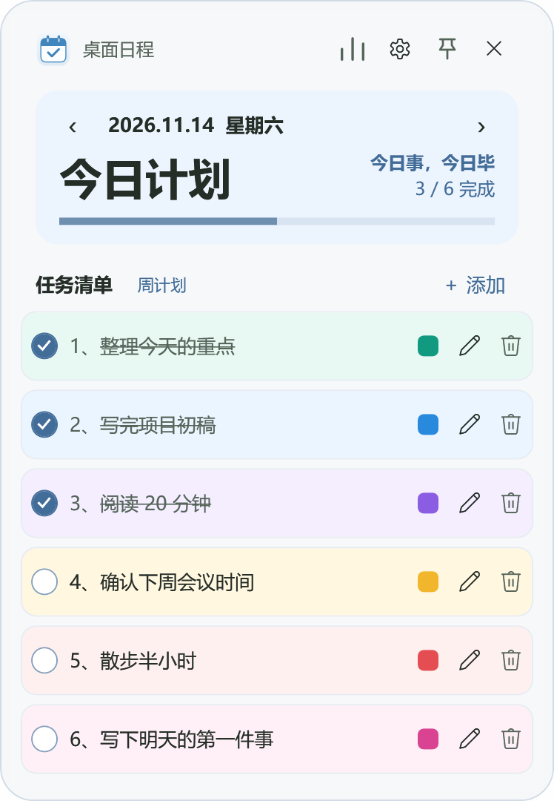
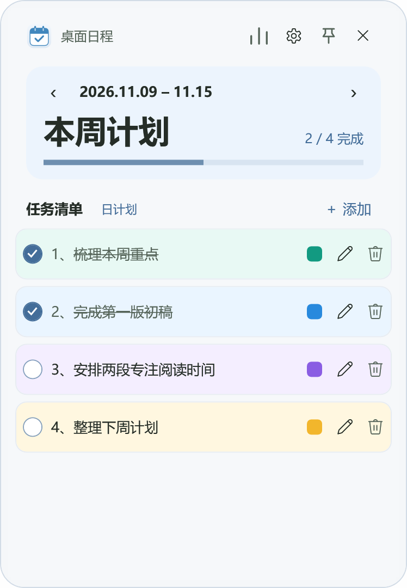
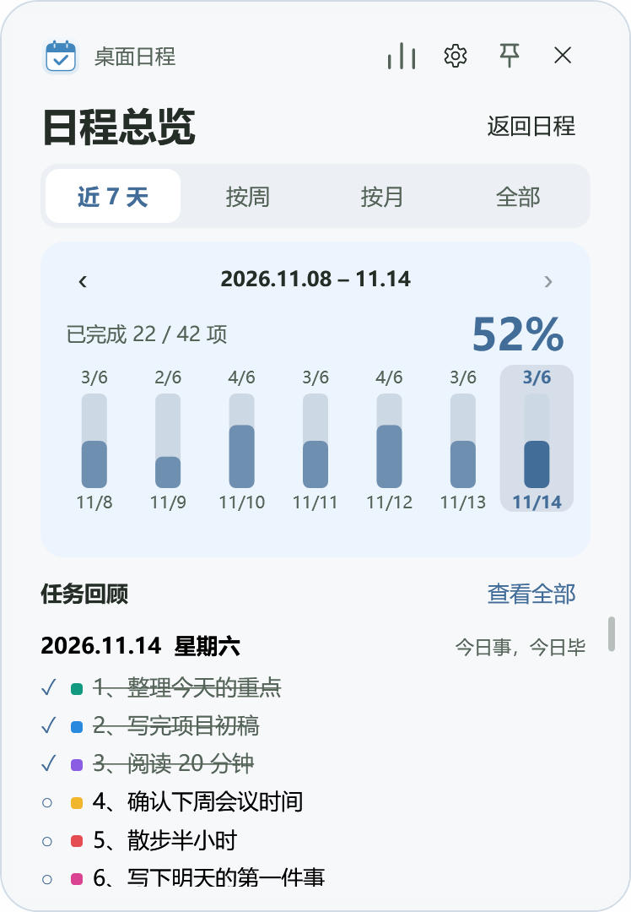

# 桌面日程

一个贴在屏幕边缘的 Windows 日程组件。鼠标移到边缘条就能展开，写完计划、勾完任务，移开鼠标就会收起。

[English](README.en.md) · [使用说明](docs/usage.zh-CN.md) · [问题反馈](https://github.com/PASSIONYOUNGZ/desktop-planner/issues)

## 下载

**当前版本 1.2.3** · Windows 10 1903 及更新版本、Windows 11（x64）

| 版本 | 功能 | ZIP 下载 | 解压后 | 下载入口 |
| --- | --- | ---: | ---: | --- |
| **本地版** | 离线日计划、周计划、总览和导出 | 0.72 MB | 1.94 MB | [CNB](https://cnb.cool/passionyoungz/desktop-planner/-/releases/download/v1.2.3/desktop-planner-1.2.3-windows-x64-local.zip) · [GitHub](https://github.com/PASSIONYOUNGZ/desktop-planner/releases/download/v1.2.3/desktop-planner-1.2.3-windows-x64-local.zip) |
| **完整版** | 本地版全部功能，另含可选的飞书双向同步 | 13.94 MB | 49.84 MB | [CNB](https://cnb.cool/passionyoungz/desktop-planner/-/releases/download/v1.2.3/desktop-planner-1.2.3-windows-x64-full.zip) · [GitHub](https://github.com/PASSIONYOUNGZ/desktop-planner/releases/download/v1.2.3/desktop-planner-1.2.3-windows-x64-full.zip) |

完整解压 ZIP 后双击 `DesktopPlanner.exe`。两版都能离线使用，本地功能无需注册或登录。之后在「高级设置 → 常规 → 关于与更新」检查更新。

## 界面预览

| 今日计划 | 周计划 | 进度总览 |
| :---: | :---: | :---: |
|  |  |  |

[个性化设置](screenshots/settings-zh.png) · [英文界面](README.en.md#screenshots)

## 功能

- **安排任务**。写日计划和周计划，按颜色区分事项，拖动排序或跨天移动。今天的清单为空时，可以接续昨天未完成的任务。
- **随时展开**。窗口可贴在屏幕任意一边。支持置顶、调整窗口大小、开机自启和自定义新建任务快捷键。
- **回顾与导出**。按近 7 天、自然周、自然月或全部查看完成率。日程可按本周、本月或全部导出为 Markdown 或 Word。
- **个性化**。支持简体中文和英文、预设与自定义主题色，以及每日随机、固定或自定义格言。

## 飞书同步

完整版可在「高级设置 → 数据」连接你有编辑权限的飞书文档。组件和文档会在后台双向同步日计划、周计划及完成状态。两台 Windows 电脑分别连接同一份文档后，可以共享这份计划。手机上可在飞书打开该文档查看。更换文档时，应用会先尝试用同一账号已有的授权。

## 数据与反馈

日程保存在程序旁的 `Data` 文件夹。移动软件或备份日程时，请一并保留这个文件夹。界面设置与飞书授权保存在当前 Windows 用户目录。

桌面日程由 [PassionYoungz](https://github.com/PASSIONYOUNGZ) 制作。完整版随包提供[飞书官方 CLI](https://github.com/larksuite/cli)及第三方许可。[版本记录](CHANGELOG.md) · [反馈问题或建议](https://github.com/PASSIONYOUNGZ/desktop-planner/issues)
